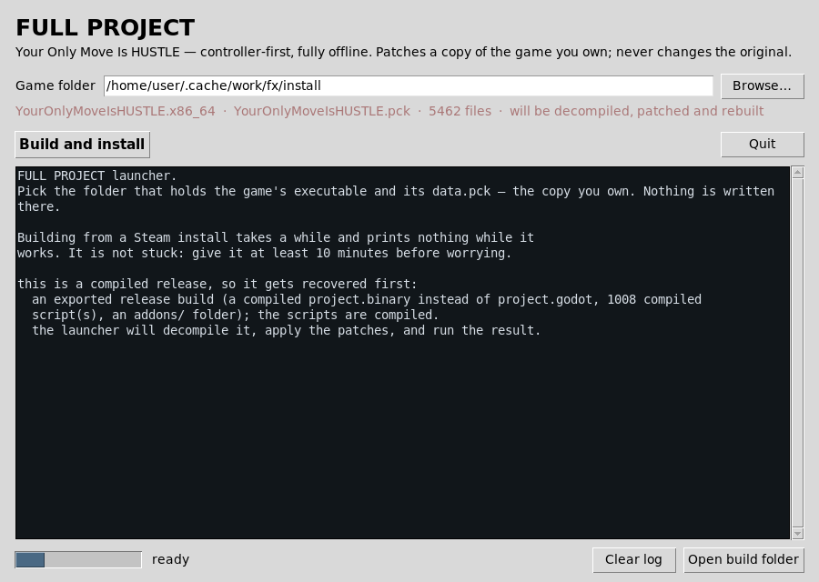
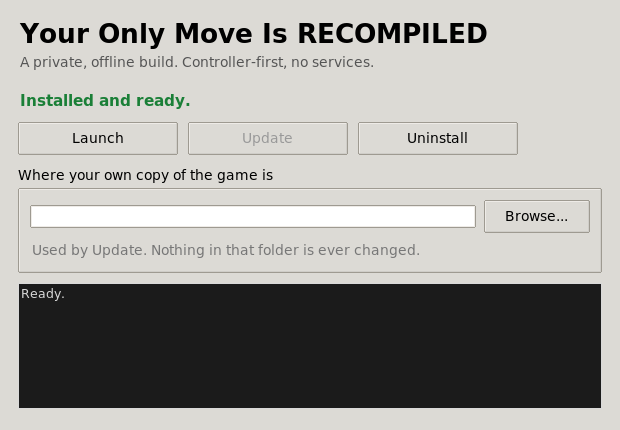

# FULL PROJECT

A controller-first, fully offline build of **Your Only Move Is HUSTLE**, delivered as a patch layer
that you apply to a copy of the game you own.

This repository contains **no game code and no game assets**. It contains:

* the scripts and scenes this project adds or changes,
* a unified diff for every upstream file it edits, applied to the copy you already own, so every
  change can be applied and reversed exactly without a single line of the game being republished,
* the launcher that applies all of it.

The launcher is a small **tkinter** window: point it at your copy, press one button, and it
unpacks, patches, repacks and runs. Nothing is written into the folder your copy of the game lives
in.

---

## What this adds

| | |
| --- | --- |
| **Full controller support** | Every screen and every move reachable with a pad alone: menus, character select, the move bar, aiming, the pause menu. |
| **A CPU opponent** | Four skill levels. It simulates candidate moves in a copy of the match and picks one — through the same submit path a human uses, so replays stay normal. |
| **Local hot seat** | Two players, one machine, one pad passed between them. Only the acting player's bar is ever drawn. |
| **Offline** | Steam, lobbies, the workshop and the network layer are removed rather than stubbed. Verified by an automated check. |
| **Replays from the pad** | **X** watches a replay mid-match; the pause menu has a playback controls toggle. |

## Requirements

* A copy of **Your Only Move Is HUSTLE** that you own (the launcher only reads it; it is never
  modified or redistributed). Either form works: the **Steam store release**, which the launcher
  decompiles for you, or an already-**decompiled source folder** (`project.godot` plus `.gd`
  scripts) if you have one.
* **Linux.** This launcher builds and installs Linux games only; the Windows path was removed
  because it could not be tested.
* **Python 3.9+** with **tkinter** (standard library otherwise — no pip install). On Debian and
  Ubuntu that is `sudo apt install python3-tk`; on Arch it is already there.
* A `patch` command: GNU patch, which every distribution ships.
* The game's own folder layout: the executable and its `.pck` in the same directory. The launcher
  works with either build in a combined install — on Linux it runs `YourOnlyMoveIsHUSTLE.x86_64`
  and ignores the `.exe`; on Windows it is the other way round — and it matches the pack whatever
  it is called (`data.pck`, `YourOnlyMoveIsHUSTLE.pck`, …).



### Two kinds of folder

The launcher accepts either:

| Folder | What it does |
| --- | --- |
| **A game install** — `YourOnlyMoveIsHUSTLE.exe`/`.x86_64` plus `YourOnlyMoveIsHUSTLE.pck` | Works on the ordinary Steam release. Unpacks the pack, recovers the project (decompiling the scripts), applies the diffs, rebuilds, and runs the result. Downloading GDRE Tools (the decompiler) on first use, ~34 MB, cached in `~/.cache/full-project`. |
| **A source folder** — `project.godot` and the `.gd` scripts | Copies the tree to `build/game-src`, applies the same diffs there, and runs it with a Godot 3.5 binary. Use this when you have the decompiled project but not a game executable. Point at the Godot binary with `--godot <path>` if it is not next to the launcher. |

### "Can the launcher decompile my Steam install and recompile it?"

Yes. That is the main path. Point it at the Steam install and it recovers the project out of the
pack with GDRE Tools, applies all 27 diffs, rebuilds it, and launches the patched game — verified
end to end: **27/27 diffs applied**, and the rebuilt game reaches its title screen with **0 errors**.
[RECOMPILE.md](RECOMPILE.md) has the measurements and the caveats (decompiled scripts lose
comments; behaviour is unaffected).

**It takes a while and prints nothing while it works.** Three slow stages, about 5–10 minutes in
total on a normal machine, and none of them show any progress:

| Stage | Typical | What it looks like |
| --- | --- | --- |
| Decompiling the pack | 1–3 min | sits on one line |
| Importing ~1,800 textures | ~2 min | "importing the project ...", then nothing |
| First boot | 10–30 s | black window |

Give it **at least 10 minutes** before deciding it is stuck, and do not close the window — the
texture import is abandoned if it is interrupted. The launcher downloads two tools on first use
(GDRE, ~34 MB, and Godot 3.5.1 if you do not already have it, ~37 MB); they are cached in
`~/.cache/full-project` and never downloaded twice.

`python3 tools/recompile/diagnose.py <folder>` reports what your install contains.

## Making a real game you can keep

After the decompile-and-patch step, `--export` turns the result into an actual game — an executable
and a `.pck`, exactly how Godot ships 3.x titles — rather than a folder you have to run with the
editor.

There is one button and no options: every build does the same thing.

```bash
python3 launcher.py --cli --game "<steam folder>" --export --install --shortcut --no-run
```

| Flag | What it does |
| --- | --- |
| `--export` | build the `.pck` + Linux executable instead of just running the project folder |
| `--install` | copy the result into `~/.local/share/YourOnlyMoveIsRECOMPILED/` |
| `--shortcut` | put the launcher icon on the desktop |
| `--uninstall` | remove both again, keeping your saves and replays |

Or just open `launcher.py`, put the game folder in the box, and press **Build and install** — it
does all four steps.

The first export downloads Godot's export templates (575 MB, once) and caches them.

What you end up with:

| | Path |
| --- | --- |
| Game | `~/.local/share/YourOnlyMoveIsRECOMPILED/` |
| Desktop icon | `~/Desktop/YourOnlyMoveIsRECOMPILED.desktop` |
| Icon files | `~/.local/share/icons/hicolor/<size>/apps/YourOnlyMoveIsRECOMPILED.png` |

### The icon on the desktop

The desktop icon does not start the game directly — it opens a small window with three buttons:



* **Launch** — start the installed game.
* **Update** — rebuild from your own copy of the game and install the result over itself. Point it
  at your game folder once and it remembers.
* **Uninstall** — remove the installed game and this icon, keeping your saves.

It is `YOMI-Launcher.py`, one file, Python and tkinter only, and it carries its own icon
(`icon.png`, installed at six sizes so a dock or menu shows it crisply). Installing copies it next
to the game along with the builder it drives, so the desktop icon keeps working even if you move or
delete the folder you built from.


## Quick start

Double-click `launcher.py`, or:

```bash
python3 launcher.py
```

A window opens and **finds your copy of the game by itself**. It runs the system `find` over your
home folder for folders named after the game and for its `.pck` / `.x86_64` / `.exe` (pruning
caches and package trees so it stays quick), checks every Steam library Steam knows about —
including ones on other drives, read out of `libraryfolders.vdf` — plus the usual per-platform
locations, your Desktop, Documents, Downloads, Games and home folder. If you own more
than one copy, they are all listed in a drop-down and you pick one; if the one it found is not the
one you want, **Browse…** to the folder holding the executable and the `.pck`.

Then press **Build and run**. It unpacks your copy, patches it, repacks it and starts it.

Two buttons do the other jobs without changing anything: **Verify my copy** checks that the game
you have is the version these patches were made against, and **Unpack only** writes a browsable
source tree to `build/unpacked`. The checkbox **Apply the patches** off gives a clean build as a
control. Everything the launcher writes goes to `build/`, which is ignored by git.

If your Python has no tkinter, or there is no display, the launcher falls back to the terminal
version of the same program.

### Terminal

Every action is available without the window — handy for scripts and for re-running a build in a
log you can read:

```bash
python3 launcher.py --cli                   # open the terminal launcher
python3 launcher.py --verify --game "/path/to/YourOnlyMoveIsHUSTLE"
```

| Flag | What it does |
| --- | --- |
| `--cli` | Use the terminal instead of the window |
| `--gui` | Force the window, even when an action flag is present |
| `--verify` | Check that your copy matches the version these patches were made against |
| `--dry-run` | Say what would happen, write nothing |
| `--unpack-only` | Unpack your copy to `build/unpacked` and stop (a browsable source tree) |
| `--no-apply` | Repack and run *without* the patch, as a control |
| `--no-run` | Build but do not launch |
| `--no-local` | Skip the local-only art and music step |
| `--game <folder>` | Point at a specific install |

Any action flag implies `--cli`, so existing scripts keep working exactly as before. A bare
`--game <folder>` opens the window with that folder already filled in.

## Controller map

| Input | Menu | In a match |
| --- | --- | --- |
| Left stick / d-pad | move focus | move the cursor highlight |
| Right stick | — | aim / DI |
| **A** | pick the highlighted tab, then press the control | use the highlighted move, or Lock In |
| **B** | back one level; from the tab row, close the panel | move → its tab → nothing selected |
| **X** | — | watch replay |
| **Y** | — | reverse (flip) |
| **LB / RB** | previous / next tab | previous / next category |
| **LT / RT** | previous / next tab | walk the categories, and **RT reaches Lock In** |
| **R3** | — | feint |
| **L3** | — | zoom out |
| **Start / Select** | — | pause menu |

The move bar is one bar: the game's own category tabs (DEFENSE, SUPER, SPECIAL, ATTACK, MOVEMENT),
the moves of whichever tab is open, and the turn column — Lock In, Hold, Free, Flip, Undo — at the
end of MOVEMENT. There are no MOVES or OPTIONS tabs to get lost between.

## Rebuilding by hand

The launcher does this automatically, but the pieces are separate if you want them:

```bash
python3 tools/build_patch.py           # apply patch/original + *.patch -> patch/modified
python3 tools/pck.py --list data.pck   # inspect a pack
```

`tools/pck.py` reads and writes the Godot 3.5 PCK format. Its writer is tested to reproduce a pack
byte for byte against Godot's own `PCKPacker`.

## Repository layout

```
patch/modified/    this project's own files, plus one unified diff per upstream file it edits
patch/index.json   the manifest: what is added, what is a diff, what is local-only
localspot/         this project's art and audio edits (derived from the game's assets: read LEGAL.md
                   before publishing a fork)
tools/pck.py       Godot 3.5 PCK reader/writer
tools/build_patch.py  regenerates the patched files from the diffs
tools/check_compliance.py  refuses to commit anything that would be a copy of the game
launcher.py        the tkinter launcher: unpack, patch, repack, run (terminal mode with --cli)
```

`patch/original/` is not here on purpose. The diffs carry their own context and are applied to the
files in **your** copy of the game, so a clone needs no game files at all — and none are shipped.

## Legal

Read [LEGAL.md](LEGAL.md) before you clone, fork or publish anything here. In short:

* **Your Only Move Is HUSTLE is © 2022 Ian Sly.** Its licence says the project can not be copied
  and/or distributed without express permission. That is why this repository ships diffs and not
  the game.
* This repository contains **no game code, no game art and no game audio**. It contains the edits
  and the original text of the files they are edited against — the minimum needed to apply a patch
  exactly and to reverse it.
* You need your own copy of the game. Nothing here lets you play it without one.
* Do not commit `localspot/`, `build/`, or anything unpacked from your copy of the game.

If you are the rights holder and you would like something here changed or removed, open an issue —
it will be actioned.

## Licence of this repository's own code

The launcher, `tools/`, and the scripts in `patch/modified/` that are original to this project are
released under the **MIT licence** (see [LICENSE](LICENSE)). The upstream files in
`patch/original/` remain the property of their author and are included only as patch context; they
are not relicensed by this repository.
